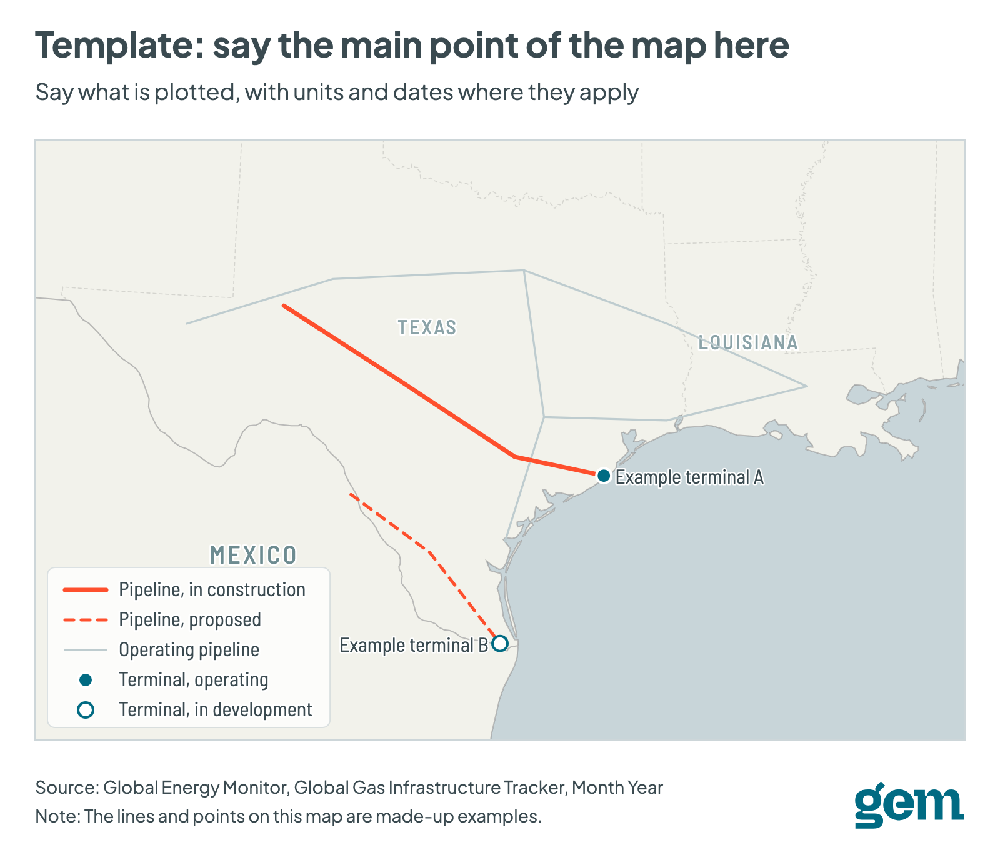
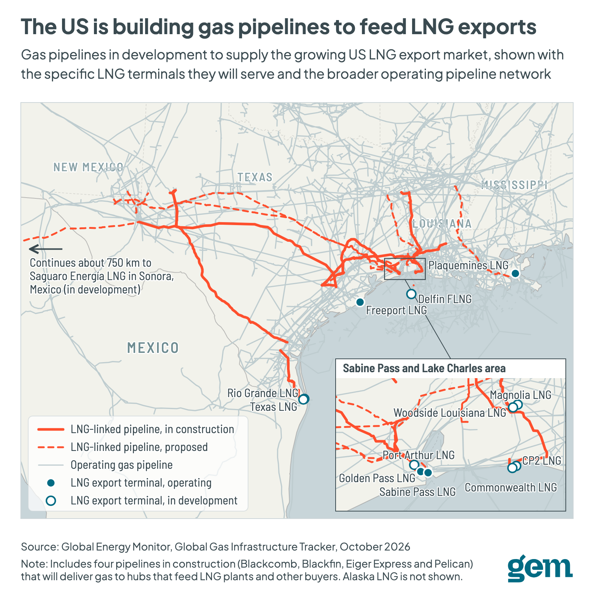
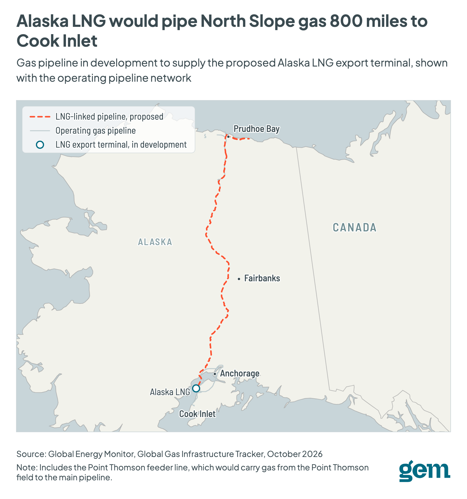

# Gallery

Figures made in this repo. Add a figure here when it is finished.

## Made with the kit

### Template map

The starting point for a new map. The lines and points are made up.

Folder: [template-map/](template-map/)

### US LNG pipelines, November 2026

US gas pipelines in construction or proposed that are linked to an LNG export terminal. Uses a conic projection, an inset and an annotation arrow.

Folder: [../writing-and-analysis/2026-11-gas-social-threads/us-lng-pipelines-map/](../writing-and-analysis/2026-11-gas-social-threads/us-lng-pipelines-map/)

### Alaska LNG, November 2026

The proposed Alaska LNG pipeline and export terminal. A simpler map with place labels.

Folder: [../writing-and-analysis/2026-11-gas-social-threads/alaska-lng-map/](../writing-and-analysis/2026-11-gas-social-threads/alaska-lng-map/)

## Legacy

### Strait of Hormuz alternatives, June 2026

The first map of this kind, made before the kit. It has its own styles and export script and does not follow the current rules: it is 1000 px wide, the logo is Midnight, and the legend and footer text are larger. Do not copy from it. Its notes on matching the shape of a Flourish chart are still useful.

Folder: [../writing-and-analysis/2026-06-goit-release/hormuz-alternatives/map/](../writing-and-analysis/2026-06-goit-release/hormuz-alternatives/map/)
